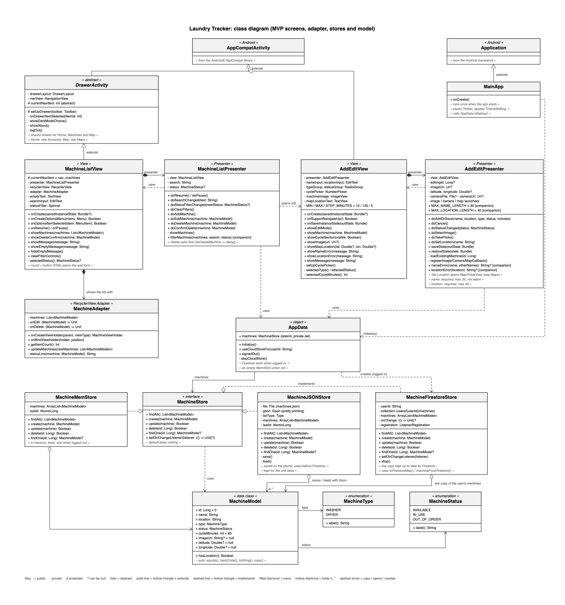

# Laundry Tracker

Laundry Tracker is a Kotlin Android app for keeping track of the laundry machines in a building, so you can check which washers and dryers are free before heading down. It was built for **Mobile Application Development** at SETU.

## Features

- **Splash screen** with the app logo and name for 2 seconds when the app opens
- **Sign up and log in with Firebase Authentication** (email and password); Firebase keeps the passwords, the app never saves them. **Enter** on the keyboard moves to the next box and submits the form, and the form moves up so the button stays above the keyboard
- **Stays logged in** between launches (Firebase remembers the user); the home screen shows who is logged in
- **Navigation drawer** on Home, Machines and Map (tap ☰ or swipe from the left) with Home, Machines, Map, Add machine, Dark mode, About and Log out, and who is logged in at the top
- **Night mode**: the app follows the phone's dark mode, or you can pick *Follow the phone / Light / Dark* from **Dark mode** in the drawer (remembered between launches); the Google maps go dark too
- **Material Design**: outlined text fields with floating labels (and a show/hide eye on passwords), filled and outlined buttons, machine cards, and a round **+** button to add a machine
- **Home screen** with a View Machines button
- **Add, list, edit and delete machines** (name, location, washer/dryer, status); Delete asks *"Delete Washer 1? This can't be undone."* first
- **Search** machines by name or location, and **filter** by status with a drop-down
- **Cycle length** picked with a NumberPicker (10–120 minutes), shown only when a machine is *In use*
- **Toolbar menu** on Machines with Clear filters
- **Back navigation** between Home → Machines → Add/Edit, and an up arrow on the Add/Edit form
- **Machine photos**: pick a photo from the phone or take one with the camera; it shows on the form and as a thumbnail in the list
- **Google Maps location**: *Set Location* on the form opens a map where you tap, long-press or drag a pin to where the machine is
- **Map of all machines**: every machine with a location is a pin, coloured by status (green available, orange in use, red out of order); tapping a pin shows its name and status, and tapping that opens the machine
- **Data validation**: a machine needs a name (at most 30 characters, and no two machines with the same name) and a location (at most 40), with character counters on the boxes; login needs an email and password; sign up checks the email, password length and that both passwords match
- **Slide transitions**: screens slide in from the right when they open and back out when you go back
- **MVP design pattern**: every screen is a View (the Activity, which only shows things and passes on taps) and a Presenter (which decides what happens), like the PlacedMark lab
- **Saved in Cloud Firestore**: each user's machines are stored in the cloud under their own account and load again after logging in on any phone; the list and map update by themselves when the data changes
- **Logging with Timber**: the stores and the main actions on each screen write to Logcat (passwords are never logged)
- **Unit tests** for the machine stores, the Firestore conversion, the machine model, the Dark mode setting, the list search/filter and the form checks

## Screens

| Screen | View | Presenter | Layout |
|---|---|---|---|
| Splash | `SplashView` | `SplashPresenter` | `activity_splash.xml` |
| Login | `LoginView` | `LoginPresenter` | `activity_login.xml` |
| Sign up | `SignupView` | `SignupPresenter` | `activity_signup.xml` |
| Home | `HomeView` | `HomePresenter` | `activity_main.xml` |
| Machines list | `MachineListView` + `MachineAdapter` | `MachineListPresenter` | `activity_machine_list.xml`, `item_machine.xml` |
| Add / Edit machine | `AddEditView` | `AddEditPresenter` | `activity_add_edit.xml` |
| Set location | `MapPickerView` | `MapPickerPresenter` | `activity_map_picker.xml` |
| Map of all machines | `MachineMapView` | `MachineMapPresenter` | `activity_machine_map.xml` |

Home, Machines and Map extend `DrawerActivity` (in `activities/`) for the navigation drawer.

## Class diagram



([SVG version](docs/laundrytracker-uml.svg))

- Every screen uses **MVP**. The View is the Activity: it finds the controls, passes each tap to its presenter as a `doX()` call (`doAddOrSave()`, `doDeleteMachine()`, `doSearchChanged()`...) and has `showX()` functions the presenter calls back (`showMachines()`, `showNameError()`, `showDeleteConfirm()`...). The Presenter holds the screen's logic: what to save, what to show and which screen opens next. It registers the Activity Result launchers through its view, the same way as the PlacedMark lab.
- The checks the presenters make are plain functions in their `companion object` (`AddEditPresenter.nameError()` / `locationError()`, `MachineListPresenter.filterMachines()`), so the unit tests can call them without Android.
- `MachineListView` and the other drawer screens extend `DrawerActivity`, an abstract class that sets up the navigation drawer once: the ☰ button, the drawer items, Dark mode, About and Log out. Each screen sets `currentNavItem` so its item is highlighted. `AddEditView` extends `AppCompatActivity` directly and has an up arrow instead.
- The machines list uses a `RecyclerView` with `MachineAdapter`, which turns each `MachineModel` into a row from `item_machine.xml`. Edit and Delete on a row call back into the presenter. Delete shows an "are you sure" dialog first, and `doConfirmDelete()` removes the machine.
- Every presenter uses the same store through `AppData.machines`, typed as the `MachineStore` interface, so the screens don't care where the machines are saved.
- `MainApp` (an `Application` class) runs once when the app starts. It plants Timber, applies the saved Dark mode and calls `AppData.initialize()`. If someone is logged in, `AppData` creates a `MachineFirestoreStore` for them; if not, an empty `MachineMemStore`. Logging in or signing up calls `AppData.useCloudStoreFor(userId)`, and logging out calls `AppData.signedOut()`. `AppData.machines` has a `private set`, so only these functions can change it (the same idea as the PlacedMark lab).
- `MachineFirestoreStore`, `MachineJSONStore` and `MachineMemStore` all implement `MachineStore`. The Firestore store is the one the app uses. It keeps a live copy of the user's machines that a Firestore snapshot listener keeps up to date, and calls `setOnChangeListener()` so the Machines list and the Map redraw when it changes. The JSON store (saved on the phone with Gson) was used before Firestore and is kept for the unit tests, along with the memory store.
- `AddEditPresenter` checks the form before saving: the name is required, at most 30 characters and not already used by another machine (ignoring capitals, and leaving out the machine being edited); the location is required and at most 40 characters. It picks a photo with the `OpenDocument` contract (keeping access with `takePersistableUriPermission`) or takes one with the `TakePicture` contract through a `FileProvider`. The photo's uri is saved in `MachineModel.imageUri`.

### Accounts and settings


([SVG version](docs/laundrytracker-uml-accounts.svg))

- `SplashView` is the launcher screen. After 2 seconds it calls `SplashPresenter.doSplashDone()`, which opens Home if someone is logged in or Login if not, then finishes so Back doesn't return to it.
- `SignupPresenter` and `LoginPresenter` use **Firebase Authentication** (`createUserWithEmailAndPassword` / `signInWithEmailAndPassword`). Firebase stores and checks the passwords, so the app never saves one. The presenters check the form first (`emailError()`, `passwordError()`, `confirmError()` in their companions, with unit tests), and errors from Firebase (email already used, wrong password, no internet) are shown on the form. On success `openHome()` loads the user's machines with `AppData.useCloudStoreFor()` and opens Home with `NEW_TASK | CLEAR_TASK`, so Back on Home closes the app instead of going back to Login.
- `Session` just asks Firebase who is logged in (`currentUser`), so the app skips Login next time. `HomePresenter` shows "Logged in as ..." from `Session.currentEmail()`. Log out in the drawer calls `Session.logout()` (Firebase `signOut()`) and `AppData.signedOut()`, then opens `LoginView`.
- `ThemeSetting` saves the Dark mode choice in SharedPreferences. `MainApp` applies it when the app starts, and the Dark mode item in `DrawerActivity` changes it, using `AppCompatDelegate.setDefaultNightMode()`.

### Maps


([SVG version](docs/laundrytracker-uml-maps.svg))

- Both map views use Google Maps' `SupportMapFragment` and implement `OnMapReadyCallback`. When `onMapReady()` is called they tell their presenter (`doMapReady()`), and the presenter tells the view where to put the camera and the pins.
- `AddEditPresenter.doSetLocation()` opens `MapPickerView` with an Activity Result launcher, starting on the machine's spot if it has one (otherwise Waterford). `MapPickerPresenter` keeps the picked point and sends the latitude and longitude back with `RESULT_OK`, like the map picker in the PlacedMark lab. The location is saved in `MachineModel.latitude` / `longitude`.
- `MachineMapPresenter` reads every machine from `AppData.machines` and only shows the ones where `hasLocation()` is true: Waterford when there are none, zoom 17 on a single pin, and a box around all of them otherwise. Tapping a pin's pop-up calls `doOpenMachine(id)`, which opens `AddEditView` for that machine.
- `MachineType.label()` and `MachineStatus.label()` give the words shown on screen, so the list and the map say the same thing.
- In dark mode both maps call `useNightStyleIfDark()` (`main/MapStyle.kt`), which loads Google's night style from `res/raw/map_style_night.json`.

## Project structure

```
app/src/main/java/org/setu/laundrytracker/
├── activities/   DrawerActivity (the shared navigation drawer)
├── views/
│   ├── splash/       SplashView, SplashPresenter
│   ├── login/        LoginView, LoginPresenter
│   ├── signup/       SignupView, SignupPresenter
│   ├── home/         HomeView, HomePresenter
│   ├── machinelist/  MachineListView, MachineListPresenter, MachineAdapter
│   ├── addedit/      AddEditView, AddEditPresenter
│   ├── mappicker/    MapPickerView, MapPickerPresenter
│   └── machinemap/   MachineMapView, MachineMapPresenter
├── main/         MainApp, AppData, Session, ThemeSetting, MapStyle
└── models/       MachineModel (+ MachineType, MachineStatus), MachineStore,
                  MachineFirestoreStore, MachineFirestoreMapper,
                  MachineMemStore, MachineJSONStore
```

## Transitions

Every screen slides in from the right when it opens and slides back out when you go back. The animations are in `res/anim/` (`slide_in_right`, `slide_out_left`, `slide_in_left`, `slide_out_right`, 250 ms from `values/integers.xml`) and are set once for the whole app with `android:windowAnimationStyle` in the light and dark themes.

## Persistence

Machines are saved in **Cloud Firestore** by `MachineFirestoreStore`, one list per user:

```
users/{userId}/machines/{machineId}
```

Each machine is one document with its name, location, type, status, cycle length, photo uri and location. `MachineFirestoreMapper` turns a `MachineModel` into those fields and back (by hand, because `MachineModel` uses `val`). New ids carry on from the highest id the user has. Firestore keeps a copy on the phone, so the app also works offline and catches up when it's back online.

The Firestore **security rules** only let a logged-in user read and write their own machines:

```
match /users/{userId}/machines/{machineId} {
  allow read, write: if request.auth != null && request.auth.uid == userId;
}
```

Photos stay on the phone (Firebase Cloud Storage would need the paid Blaze plan). Photos picked from the phone are saved as their `content://` uri and photos taken with the camera as files in `files/images/`, so a machine's photo only shows on the phone it was added on.

The Dark mode choice is kept in SharedPreferences (`shared_prefs/settings.xml`). To see the app's files, open **View → Tool Windows → Device Explorer** in Android Studio and go to `data/data/org.setu.laundrytracker/`. To see the machines, open **Firestore Database** in the Firebase Console.

## Logging

The app logs with [Timber](https://github.com/JakeWharton/timber), planted once in `MainApp`. Open **Logcat** in Android Studio and filter by `org.setu.laundrytracker` to see messages like:

```
D/LoginPresenter: Login ok for test@example.com
D/AppData: Using Firestore machines for user WHbCn6yPkZMg...
D/MachineFirestoreStore: load: 1 machines from Firestore
D/MachineFirestoreStore: create: id=2, name=Dryer 1
D/AddEditPresenter: Save blocked: A machine called Dryer 1 already exists
```

Logins and sign ups only log the email and whether it worked. Passwords are never logged.

## Running the app

1. Open the project folder in Android Studio.
2. Add the Firebase config file `app/google-services.json` (see below).
3. Add a Google Maps API key to `local.properties` (see below).
4. Let Gradle sync, choose an emulator with Google APIs (e.g. Pixel 4a, API 34) and press **Run**.

### Firebase

The app uses a Firebase project with **Authentication (Email/Password)** and **Cloud Firestore** turned on. In the Firebase Console, add an Android app with the package `org.setu.laundrytracker`, download its `google-services.json` and put it in the `app/` folder. The Google Services Gradle plugin reads it at build time. `google-services.json` is git-ignored, so it isn't in this repository.

### Google Maps API key

The maps need a key for the **Maps SDK for Android** from the Google Cloud Console (restrict it to Android apps with the package `org.setu.laundrytracker` and your debug SHA-1). Put it in `local.properties` in the project folder:

```
MAPS_API_KEY=your-key-here
```

`build.gradle.kts` reads it from there and puts it in the manifest. `local.properties` is git-ignored, so the key is never committed. Without a key the app still builds, but the maps stay grey.

From the terminal:

```bash
./gradlew assembleDebug testDebugUnitTest lintDebug
```

## Tests

There are 54 unit tests in `app/src/test/java/org/setu/laundrytracker/`. Run them with `./gradlew testDebugUnitTest`.

In `models/`:

- `MachineMemStoreTest`: create, update, delete and cycle length on the in-memory store
- `MachineJSONStoreTest`: saves to a temporary file, then reopens it to check machines, edits, deletes, ids, photos and locations are kept, and that machines saved before photos or locations existed still load. It also checks the file is pretty-printed and that saving into a folder that doesn't exist yet works
- `MachineModelTest`: `hasLocation()` is only true when both latitude and longitude are set, and the type/status labels
- `MachineFirestoreMapperTest`: a machine comes back the same after going to a Firestore document and back, enums are saved as their names, Firestore's `Long` numbers are converted, and missing or unknown fields fall back to the defaults

In `main/`:

- `ThemeSettingTest`: each Dark mode choice turns into the right AppCompat night mode

In `views/`:

- `machinelist/MachineListFilterTest`: searching by name or location (any capitals) and filtering by status
- `addedit/MachineFormCheckTest`: empty, too long and already-used names, and empty or too long locations
- `login/LoginCheckTest`: email and password are required
- `signup/SignupCheckTest`: good and bad emails, the 6 character password minimum and the confirm password

## Built with

Kotlin, AndroidX AppCompat, Material Components (DayNight theme, NavigationView, TextInputLayout, MaterialCardView, FloatingActionButton), DrawerLayout, RecyclerView, Google Maps SDK for Android, Firebase (Authentication, Cloud Firestore), Activity Result APIs, FileProvider, Gson, Timber, JUnit.

## Development

Each feature has a GitHub issue, its own branch and small commits that reference the issue, merged into `main` through a pull request.

## Releases

- **v1.0**: the first full release (machines, photos, maps, navigation drawer, night mode, saved as JSON on the phone).
- **v2.0**: the final version for Assignment 2: Firebase login and Cloud Firestore, the MVP design pattern on every screen, slide transitions, more data validation and the Delete confirmation.

See [Releases](https://github.com/yijielim0116/LaundryTracker/releases).
