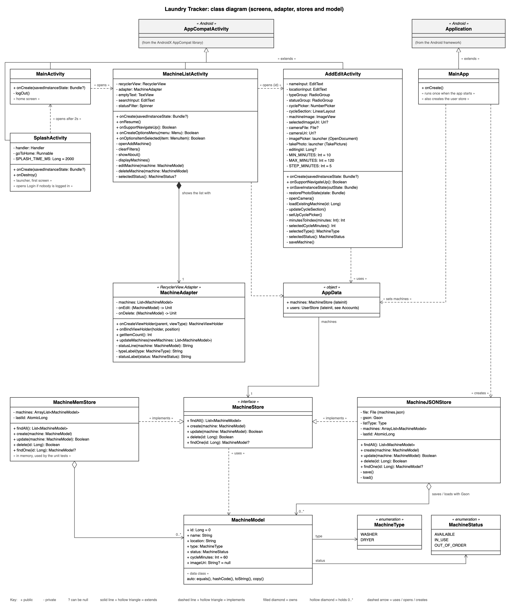
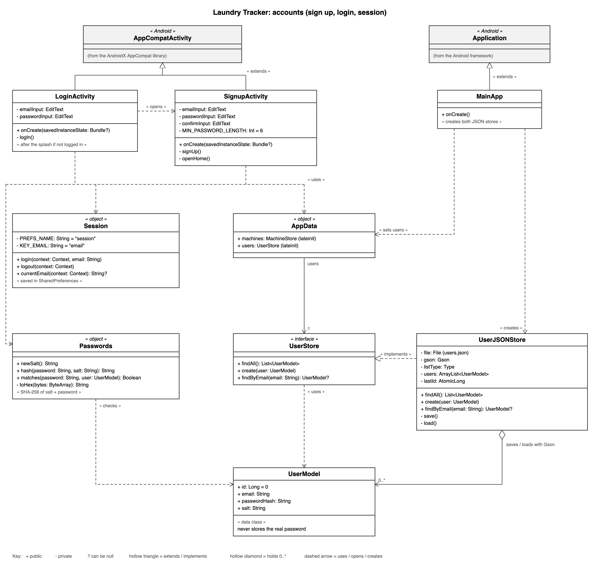

# Laundry Tracker

Laundry Tracker is a Kotlin Android app for keeping track of the laundry machines in a building, so you can check which washers and dryers are free before heading down. It was built for **Mobile Application Development (Assignment 1)** at SETU.

## Features

- **Splash screen** with the app logo and name for 2 seconds when the app opens
- **Sign up and log in**: accounts are saved with salted SHA-256 password hashes, never the real password
- **Stays logged in** between launches; the home screen shows who is logged in and has a **Log out** button
- **Home screen** with a View Machines button
- **Add, list, edit and delete machines** (name, location, washer/dryer, status)
- **Search** machines by name or location, and **filter** by status with a drop-down
- **Cycle length** picked with a NumberPicker (10–120 minutes), shown only when a machine is *In use*
- **Toolbar menu** with Add, Clear filters and About
- **Up / Back navigation** between Home → Machines → Add/Edit
- **Machine photos**: pick a photo from the phone or take one with the camera; it shows on the form and as a thumbnail in the list
- **Data validation**: a machine must have a name; sign up checks the email, password length and that both passwords match
- **Saved to JSON**: machines are kept in `machines.json` and are still there after the app is closed
- **Unit tests** for the machine stores and the user store

## Screens

| Screen | Class | Layout |
|---|---|---|
| Splash | `SplashActivity` | `activity_splash.xml` |
| Login | `LoginActivity` | `activity_login.xml` |
| Sign up | `SignupActivity` | `activity_signup.xml` |
| Home | `MainActivity` | `activity_main.xml` |
| Machines list | `MachineListActivity` + `MachineAdapter` | `activity_machine_list.xml`, `item_machine.xml` |
| Add / Edit machine | `AddEditActivity` | `activity_add_edit.xml` |

## Class diagram



([SVG version](docs/laundrytracker-uml.svg))

- The screens extend `AppCompatActivity`. `SplashActivity` is the launcher screen. After 2 seconds it opens Home if someone is logged in, or Login if not, then finishes so Back doesn't return to it. Home opens the list, and the list opens the form (sending the machine's id when editing).
- The machines list uses a `RecyclerView` with `MachineAdapter`, which turns each `MachineModel` into a row from `item_machine.xml`.
- Every screen uses the same store through `AppData.machines`, typed as the `MachineStore` interface.
- `MainApp` (an `Application` class) runs once when the app starts and sets `AppData.machines` to a `MachineJSONStore` and `AppData.users` to a `UserJSONStore`.
- `MachineJSONStore` and `MachineMemStore` both implement `MachineStore`. The JSON store saves to a file with Gson; the memory store is used in the unit tests.
- `AddEditActivity` picks a photo with the `OpenDocument` contract (keeping access with `takePersistableUriPermission`) or takes one with the `TakePicture` contract through a `FileProvider`. The photo's uri is saved in `MachineModel.imageUri`.

### Accounts



([SVG version](docs/laundrytracker-uml-accounts.svg))

- `LoginActivity` and `SignupActivity` use `AppData.users` (a `UserStore`), `Passwords` and `Session`.
- `UserJSONStore` implements `UserStore` and saves `UserModel`s to `users.json` with Gson.
- `Passwords` makes a random salt for each user and stores a SHA-256 hash of salt + password, so the real password is never saved.
- `Session` keeps the logged-in email in SharedPreferences, so the app skips Login next time. Logging out clears it.

## Project structure

```
app/src/main/java/org/setu/laundrytracker/
├── activities/   SplashActivity, LoginActivity, SignupActivity, MainActivity,
│                 MachineListActivity, AddEditActivity
├── adapters/     MachineAdapter
├── main/         MainApp, AppData, Session
└── models/       MachineModel (+ MachineType, MachineStatus), MachineStore,
                  MachineMemStore, MachineJSONStore,
                  UserModel, UserStore, UserJSONStore, Passwords
```

## Persistence

Machines are saved by `MachineJSONStore` to `machines.json` in the app's private storage (`/data/data/org.setu.laundrytracker/files/`). The whole list is written after every add, edit or delete and read back when the app starts. New ids carry on from the highest saved id, so an id is never reused.

Accounts are saved the same way by `UserJSONStore` to `users.json`. Each user is stored as an email, a password hash and a salt.

Photos picked from the phone are saved as their `content://` uri. Photos taken with the camera are saved as files in `files/images/`.

Who is logged in is kept in SharedPreferences (`shared_prefs/session.xml`).

To see the files, open **View → Tool Windows → Device Explorer** in Android Studio and go to `data/data/org.setu.laundrytracker/`.

## Running the app

1. Open the project folder in Android Studio.
2. Let Gradle sync, choose an emulator (e.g. Pixel 4a, API 34) and press **Run**.

From the terminal:

```bash
./gradlew assembleDebug testDebugUnitTest lintDebug
```

## Tests

Unit tests are in `app/src/test/java/org/setu/laundrytracker/models/`:

- `MachineMemStoreTest`: create, update, delete and cycle length on the in-memory store
- `MachineJSONStoreTest`: saves to a temporary file, then reopens it to check machines, edits, deletes, ids and photos are kept, and that machines saved before photos existed still load
- `UserJSONStoreTest`: users are kept after reopening, email lookup ignores capitals, the password isn't saved as plain text, right/wrong passwords, and a broken file doesn't crash

## Built with

Kotlin, AndroidX AppCompat, RecyclerView, Activity Result APIs, FileProvider, Gson, JUnit.

## Development

Each feature has a GitHub issue, its own branch and small commits that reference the issue, merged into `main` through a pull request.
