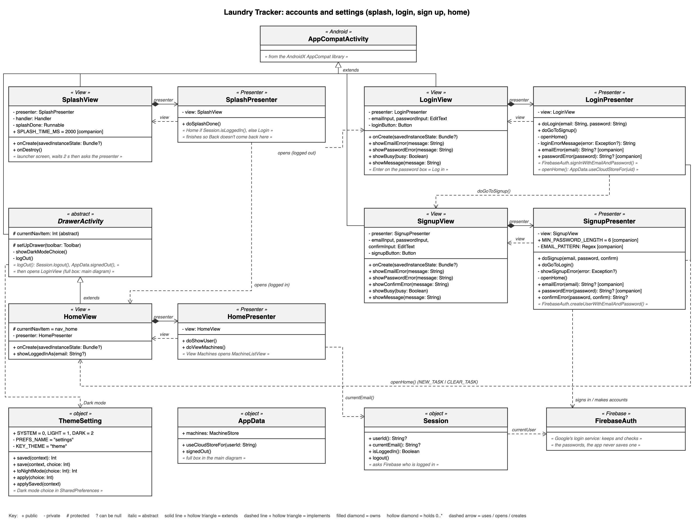
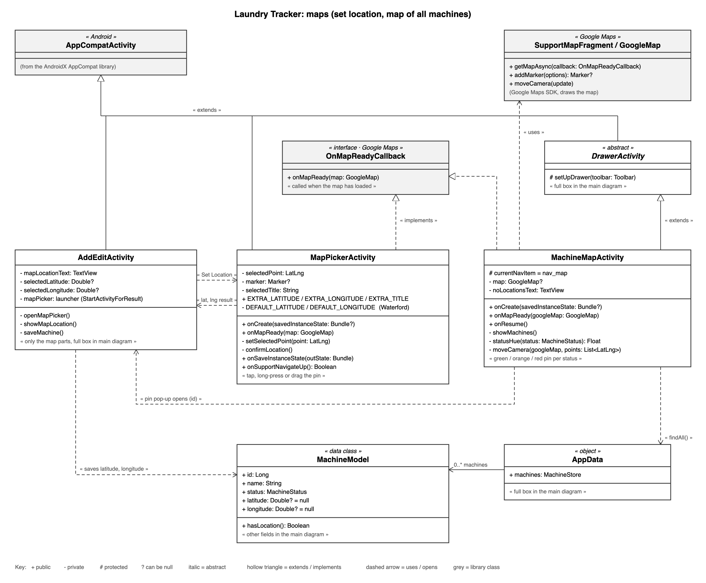

# Laundry Tracker

Laundry Tracker is a Kotlin Android app for keeping track of the laundry machines in a building, so you can check which washers and dryers are free before heading down. It was built for **Mobile Application Development** at SETU.

## Features

- **Splash screen** with the app logo and name for 2 seconds when the app opens
- **Sign up and log in with Firebase Authentication** (email and password); Firebase keeps the passwords, the app never saves them
- **Stays logged in** between launches (Firebase remembers the user); the home screen shows who is logged in
- **Navigation drawer** on Home, Machines and Map (tap ☰ or swipe from the left) with Home, Machines, Map, Add machine, Dark mode, About and Log out, and who is logged in at the top
- **Night mode**: the app follows the phone's dark mode, or you can pick *Follow the phone / Light / Dark* from **Dark mode** in the drawer (remembered between launches); the Google maps go dark too
- **Material Design**: outlined text fields with floating labels (and a show/hide eye on passwords), filled and outlined buttons, machine cards, and a round **+** button to add a machine
- **Home screen** with a View Machines button
- **Add, list, edit and delete machines** (name, location, washer/dryer, status)
- **Search** machines by name or location, and **filter** by status with a drop-down
- **Cycle length** picked with a NumberPicker (10–120 minutes), shown only when a machine is *In use*
- **Toolbar menu** on Machines with Clear filters
- **Back navigation** between Home → Machines → Add/Edit, and an up arrow on the Add/Edit form
- **Machine photos**: pick a photo from the phone or take one with the camera; it shows on the form and as a thumbnail in the list
- **Google Maps location**: *Set Location* on the form opens a map where you tap, long-press or drag a pin to where the machine is
- **Map of all machines**: every machine with a location is a pin, coloured by status (green available, orange in use, red out of order); tapping a pin shows its name and status, and tapping that opens the machine
- **Data validation**: a machine must have a name; sign up checks the email, password length and that both passwords match
- **Saved in Cloud Firestore**: each user's machines are stored in the cloud under their own account and load again after logging in on any phone; the list and map update by themselves when the data changes
- **Logging with Timber**: the stores and the main actions on each screen write to Logcat (passwords are never logged)
- **Unit tests** for the machine stores, the Firestore conversion, the machine model and the Dark mode setting

## Screens

| Screen | Class | Layout |
|---|---|---|
| Splash | `SplashActivity` | `activity_splash.xml` |
| Login | `LoginActivity` | `activity_login.xml` |
| Sign up | `SignupActivity` | `activity_signup.xml` |
| Home | `MainActivity` | `activity_main.xml` |
| Machines list | `MachineListActivity` + `MachineAdapter` | `activity_machine_list.xml`, `item_machine.xml` |
| Add / Edit machine | `AddEditActivity` | `activity_add_edit.xml` |
| Set location | `MapPickerActivity` | `activity_map_picker.xml` |
| Map of all machines | `MachineMapActivity` | `activity_machine_map.xml` |

## Class diagram


([SVG version](docs/laundrytracker-uml.svg))

- The screens extend `AppCompatActivity`. Home and Machines extend it through `DrawerActivity`, an abstract class that sets up the navigation drawer once for both: the ☰ button, the drawer items, About and Log out. Each screen sets `currentNavItem` so its item is highlighted. `SplashActivity` is the launcher screen. After 2 seconds it opens Home if someone is logged in, or Login if not, then finishes so Back doesn't return to it. Home opens the list, and the list opens the form (sending the machine's id when editing).
- The machines list uses a `RecyclerView` with `MachineAdapter`, which turns each `MachineModel` into a row from `item_machine.xml`.
- Every screen uses the same store through `AppData.machines`, typed as the `MachineStore` interface, so the screens don't care where the machines are saved.
- `MainApp` (an `Application` class) runs once when the app starts. It plants Timber and calls `AppData.initialize()`. If someone is logged in, `AppData` creates a `MachineFirestoreStore` for them; if not, an empty `MachineMemStore`. Logging in or signing up calls `AppData.useCloudStoreFor(userId)`, and logging out calls `AppData.signedOut()`. `AppData.machines` has a `private set`, so only these functions can change it (the same idea as the PlacedMark lab).
- `MachineFirestoreStore`, `MachineJSONStore` and `MachineMemStore` all implement `MachineStore`. The Firestore store is the one the app uses. It keeps a live copy of the user's machines that a Firestore snapshot listener keeps up to date, and calls `setOnChangeListener()` so the Machines list and the Map redraw when it changes. The JSON store (saved on the phone with Gson) was used before Firestore and is kept for the unit tests, along with the memory store.
- `AddEditActivity` picks a photo with the `OpenDocument` contract (keeping access with `takePersistableUriPermission`) or takes one with the `TakePicture` contract through a `FileProvider`. The photo's uri is saved in `MachineModel.imageUri`.

### Accounts and settings



([SVG version](docs/laundrytracker-uml-accounts.svg))

- `SignupActivity` and `LoginActivity` use **Firebase Authentication** (`createUserWithEmailAndPassword` / `signInWithEmailAndPassword`). Firebase stores and checks the passwords, so the app never saves one. Errors from Firebase (email already used, wrong password, no internet) are shown on the form.
- `Session` just asks Firebase who is logged in (`currentUser`), so the app skips Login next time. Log out in the drawer calls `Session.logout()` (Firebase `signOut()`) and `AppData.signedOut()`.
- `ThemeSetting` (in the Settings part of the diagram) saves the Dark mode choice in SharedPreferences. `MainApp` applies it when the app starts, and the Dark mode item in `DrawerActivity` changes it, using `AppCompatDelegate.setDefaultNightMode()`.

### Maps



([SVG version](docs/laundrytracker-uml-maps.svg))

- Both map screens use Google Maps' `SupportMapFragment` and implement `OnMapReadyCallback`, so they add their pins once `onMapReady()` is called.
- `AddEditActivity` opens `MapPickerActivity` with an Activity Result launcher and gets the latitude and longitude back, like the map picker in the PlacedMark lab. The location is saved in `MachineModel.latitude` / `longitude`.
- `MachineMapActivity` extends `DrawerActivity`, reads every machine from `AppData.machines`, and only shows the ones where `hasLocation()` is true. Tapping a pin's pop-up opens `AddEditActivity` with that machine's id.
- `MachineType.label()` and `MachineStatus.label()` give the words shown on screen, so the list and the map say the same thing.
- In dark mode both maps call `useNightStyleIfDark()` (`main/MapStyle.kt`), which loads Google's night style from `res/raw/map_style_night.json`.

## Project structure

```
app/src/main/java/org/setu/laundrytracker/
├── activities/   SplashActivity, LoginActivity, SignupActivity, DrawerActivity,
│                 MainActivity, MachineListActivity, AddEditActivity,
│                 MapPickerActivity, MachineMapActivity
├── adapters/     MachineAdapter
├── main/         MainApp, AppData, Session, ThemeSetting, MapStyle
└── models/       MachineModel (+ MachineType, MachineStatus), MachineStore,
                  MachineFirestoreStore, MachineFirestoreMapper,
                  MachineMemStore, MachineJSONStore
```

## Persistence

Machines are saved in **Cloud Firestore** by `MachineFirestoreStore`, one list per user:

```
users/{userId}/machines/{machineId}
```

Each machine is one document with its name, location, type, status, cycle length, photo uri and location. `MachineFirestoreMapper` turns a `MachineModel` into those fields and back (by hand, because `MachineModel` uses `val`). New ids carry on from the highest id the user has. Firestore keeps a copy on the phone, so the app also works offline and catches up when it's back online.

The Firestore **security rules** only let a logged-in user read and write their own machines:

```
match /users/{userId}/machines/{machineId} {
  allow read, write: if request.auth != null && request.auth.uid == userId;
}
```

Photos stay on the phone (Firebase Cloud Storage would need the paid Blaze plan). Photos picked from the phone are saved as their `content://` uri and photos taken with the camera as files in `files/images/`, so a machine's photo only shows on the phone it was added on.

The Dark mode choice is kept in SharedPreferences (`shared_prefs/settings.xml`). To see the app's files, open **View → Tool Windows → Device Explorer** in Android Studio and go to `data/data/org.setu.laundrytracker/`. To see the machines, open **Firestore Database** in the Firebase Console.

## Logging

The app logs with [Timber](https://github.com/JakeWharton/timber), planted once in `MainApp`. Open **Logcat** in Android Studio and filter by `org.setu.laundrytracker` to see messages like:

```
D/LoginActivity: Login ok for test@example.com
D/AppData: Using Firestore machines for user WHbCn6yPkZMg...
D/MachineFirestoreStore: load: 1 machines from Firestore
D/MachineFirestoreStore: create: id=2, name=Dryer 1
```

Logins and sign ups only log the email and whether it worked. Passwords are never logged.

## Running the app

1. Open the project folder in Android Studio.
2. Add the Firebase config file `app/google-services.json` (see below).
3. Add a Google Maps API key to `local.properties` (see below).
4. Let Gradle sync, choose an emulator with Google APIs (e.g. Pixel 4a, API 34) and press **Run**.

### Firebase

The app uses a Firebase project with **Authentication (Email/Password)** and **Cloud Firestore** turned on. In the Firebase Console, add an Android app with the package `org.setu.laundrytracker`, download its `google-services.json` and put it in the `app/` folder. The Google Services Gradle plugin reads it at build time. `google-services.json` is git-ignored, so it isn't in this repository.

### Google Maps API key

The maps need a key for the **Maps SDK for Android** from the Google Cloud Console (restrict it to Android apps with the package `org.setu.laundrytracker` and your debug SHA-1). Put it in `local.properties` in the project folder:

```
MAPS_API_KEY=your-key-here
```

`build.gradle.kts` reads it from there and puts it in the manifest. `local.properties` is git-ignored, so the key is never committed. Without a key the app still builds, but the maps stay grey.

From the terminal:

```bash
./gradlew assembleDebug testDebugUnitTest lintDebug
```

## Tests

Unit tests are in `app/src/test/java/org/setu/laundrytracker/models/`:

- `MachineMemStoreTest`: create, update, delete and cycle length on the in-memory store
- `MachineJSONStoreTest`: saves to a temporary file, then reopens it to check machines, edits, deletes, ids, photos and locations are kept, and that machines saved before photos or locations existed still load
- `MachineModelTest`: `hasLocation()` is only true when both latitude and longitude are set, and the type/status labels
- `MachineFirestoreMapperTest`: a machine comes back the same after going to a Firestore document and back, enums are saved as their names, Firestore's `Long` numbers are converted, and missing or unknown fields fall back to the defaults

And in `app/src/test/java/org/setu/laundrytracker/main/`:

- `ThemeSettingTest`: each Dark mode choice turns into the right AppCompat night mode

The JSON store tests also check the file is pretty-printed and that saving into a folder that doesn't exist yet works.

## Built with

Kotlin, AndroidX AppCompat, Material Components (DayNight theme, NavigationView, TextInputLayout, MaterialCardView, FloatingActionButton), DrawerLayout, RecyclerView, Google Maps SDK for Android, Firebase (Authentication, Cloud Firestore), Activity Result APIs, FileProvider, Gson, Timber, JUnit.

## Development

Each feature has a GitHub issue, its own branch and small commits that reference the issue, merged into `main` through a pull request.

## Releases

- **v1.0**: the first full release, with every feature above. See [Releases](https://github.com/yijielim0116/LaundryTracker/releases).
